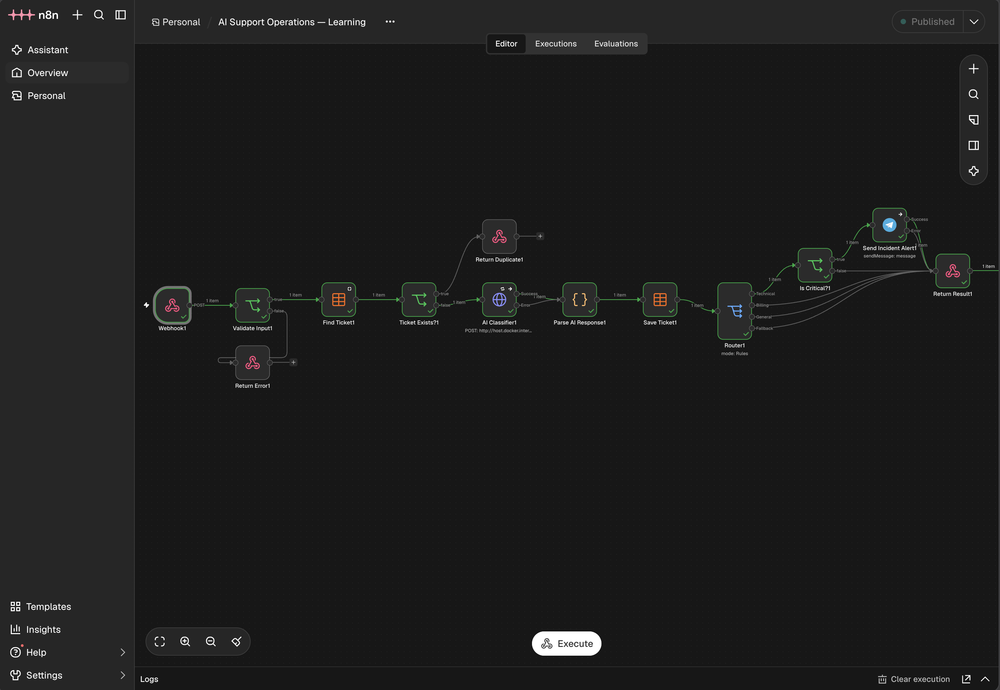
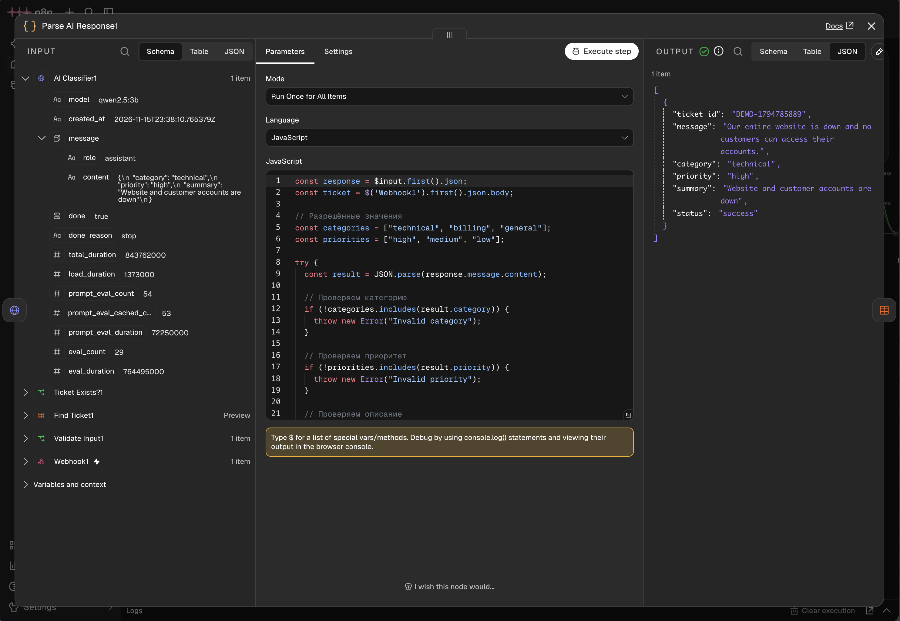
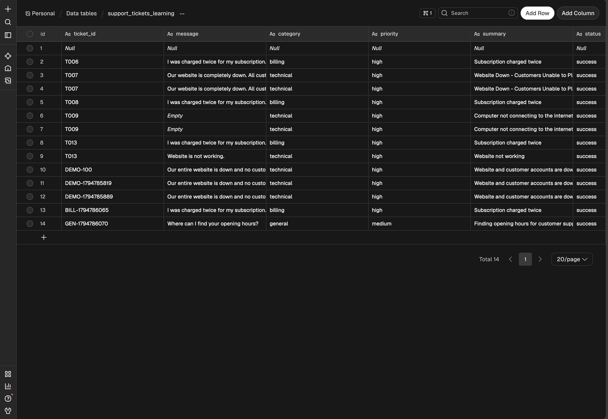
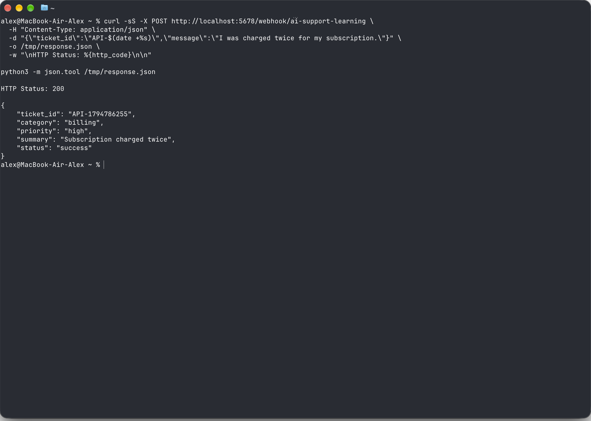
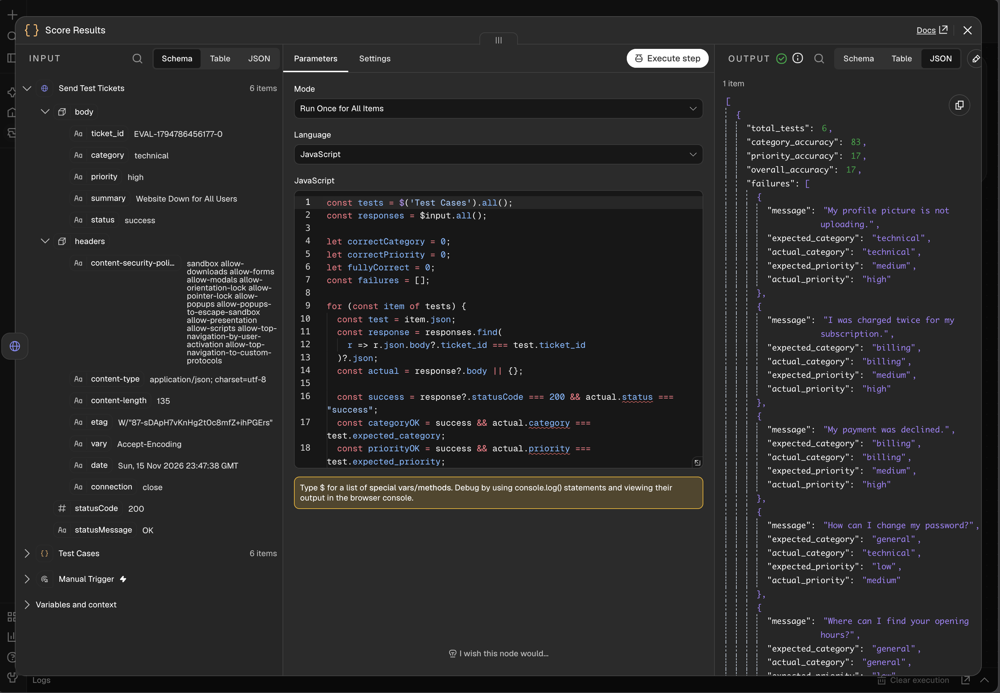
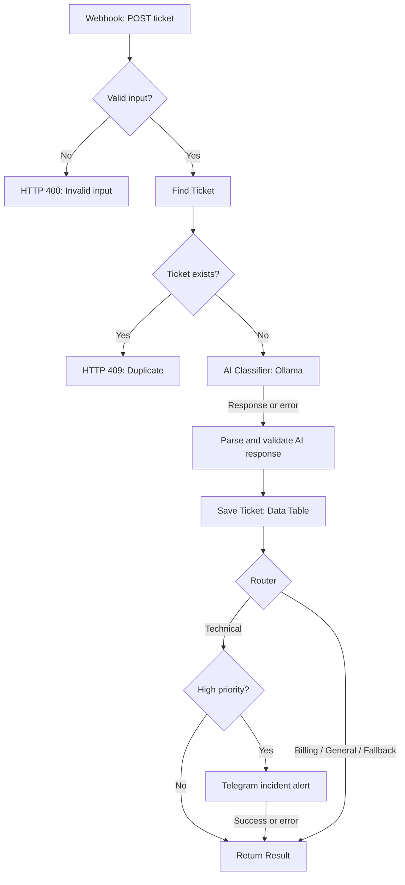

# AI Support Operations

**AI-powered support ticket classification, routing, and incident alerts built with n8n and Ollama.**

A hands-on AI automation portfolio project that transforms incoming support messages into structured, actionable tickets. It combines a local language model with REST APIs, JavaScript validation, persistent storage, and Telegram notifications.

## Overview

Support teams often spend time reading incoming tickets, identifying their urgency, and deciding which department should handle them. This project automates that initial triage process.

The workflow receives a support ticket through a webhook, validates the input, checks for duplicates, classifies the ticket using a local AI model, stores the result, and routes it to the appropriate category. Critical technical incidents trigger a Telegram notification. The API returns a structured response to the caller.

**Project status:** Local, working portfolio prototype. It demonstrates an end-to-end workflow, not a production-ready support platform.

## Demo

### 1. Main automation workflow

<!-- Upload your n8n screenshot to screenshots/workflow.png, then uncomment the image line below. -->
<!--  -->

*The complete n8n workflow, from incoming requests to AI classification, storage, routing, and incident alerts.*

### 2. AI classification result

<!--  -->

*An example of a support ticket converted into structured JSON by the local AI model.*

### 3. Ticket storage

<!--  -->

*Processed tickets stored in n8n Data Tables, including their category, priority, summary, and processing status.*

### 4. Telegram incident alert


*An automated alert sent when a ticket is classified as a high-priority technical incident.*

### 5. API request and response

<!--  -->

*A client sends a support message and receives a structured result through the webhook API.*

### 6. AI evaluation

<!--  -->

*An independent evaluation workflow compares the model's predictions with predefined expected answers.*

## Business value

- **Less manual triage:** automatically categorizes incoming requests and summarizes their content.
- **Faster incident awareness:** alerts the team when a critical technical issue is identified.
- **Consistent processing:** validates the model's output against predefined rules.
- **Traceability:** stores tickets and their processing status for review.
- **Local AI inference:** runs the language model through Ollama without sending ticket text to a cloud AI API.

These are intended benefits. Actual time savings and production accuracy have not been measured.

## Architecture



## Features

| Feature | Implementation |
| --- | --- |
| REST API | POST webhook accepts a ticket ID and message and returns JSON. |
| Input validation | Rejects missing, empty, or non-string required fields with HTTP 400. |
| Duplicate protection | Checks the ticket ID before processing and returns HTTP 409 for existing tickets. |
| AI classification | Qwen 2.5 3B, served locally through Ollama. |
| Output validation | JavaScript checks allowed categories, priorities, and a non-empty summary. |
| Routing | Technical, billing, general, and manual-review paths. |
| Persistence | n8n Data Tables stores processed tickets. |
| Incident alerts | Telegram Bot API notifies the configured chat about critical technical tickets. |
| Error handling | AI request retries and a manual-review fallback; Telegram errors do not block the API response. |
| AI evaluation | Six labeled test cases, unique IDs per run, accuracy calculation, and failure reporting. |

## Tech stack

| Technology | Purpose |
| --- | --- |
| n8n | Workflow orchestration, webhooks, routing, and data storage |
| Ollama | Local LLM inference API |
| Qwen 2.5 3B | Ticket classification and summarization |
| JavaScript | Input/output processing, validation, and evaluation |
| Docker | Local n8n runtime |
| REST / HTTP / JSON | Communication between services |
| Telegram Bot API | Incident notifications |

## Getting started

### Requirements

- A running n8n instance (with Data Tables support)
- Ollama installed and running
- The `qwen2.5:3b` model
- A Telegram bot and a personal chat ID for notifications (optional for the core classification demo)

### 1. Start the local services

Example for macOS with Docker Desktop:

```bash
docker volume create n8n_data
docker run -d --name n8n \
  -p 127.0.0.1:5678:5678 \
  -v n8n_data:/home/node/.n8n \
  docker.n8n.io/n8nio/n8n
```

If you already have an n8n container, start it instead of creating a second one: `docker start n8n`.

With Ollama running, install the model:

```bash
ollama pull qwen2.5:3b
```

Open n8n at `http://localhost:5678`.

### 2. Import the workflows

Import `ai-support-workflow.json` and `ai-support-evaluation.json` into n8n using **Import from File**.

The main workflow calls Ollama at `http://host.docker.internal:11434/api/chat`. This address is intended for Docker Desktop on macOS. Adjust it if you use a different environment.

### 3. Configure ticket storage

Create a Data Table named `support_tickets_learning` with these string columns:

```text
ticket_id, message, category, priority, summary, status
```

Select the new table in both **Find Ticket** and **Save Ticket**. Use the matching `ticket_id` lookup and automatic column mapping for insertion. Imported workflows may contain references to the original table, so reconnect them to your local table.

### 4. Configure Telegram

Create a bot using [BotFather](https://t.me/BotFather), start a conversation with it, and obtain your personal chat ID. In n8n, create a Telegram credential and select it in **Send Incident Alert**.

If you skip Telegram setup, bypass the notification node by connecting the **True** output of **Is Critical?** directly to **Return Result**. The core ticket workflow will still work.

Never commit a bot token, credentials, or personal chat ID to this repository.

### 5. Publish and test

Publish or activate the main workflow before using its production webhook URL locally.

```bash
curl -i -X POST http://localhost:5678/webhook/ai-support-learning \
  -H 'Content-Type: application/json' \
  -d '{"ticket_id":"DEMO-001","message":"I was charged twice for my subscription."}'
```

Example response (illustrative; actual model output may vary):

```json
{
  "ticket_id": "DEMO-001",
  "category": "billing",
  "priority": "medium",
  "summary": "Customer was charged twice for their subscription.",
  "status": "success"
}
```

Use a new ticket ID for each new request. To test duplicates, repeat the same ID. For the n8n test webhook instead of the published webhook, use `/webhook-test/ai-support-learning` after starting **Listen for test event**.

## API behavior

| Scenario | Expected result |
| --- | --- |
| Valid new ticket | HTTP 200; structured classification, stored ticket. |
| Empty or missing required field | HTTP 400; validation error. |
| Existing ticket ID | HTTP 409; duplicate is not processed again. |
| AI unavailable or invalid output | HTTP 200; ticket saved with `manual_review` status. |
| Critical technical issue | Ticket saved and Telegram alert attempted. |

The current API returns the ticket processing result, not a guarantee that a Telegram notification was delivered.

## AI evaluation

The separate evaluation workflow sends six labeled support tickets to the published webhook. It compares the returned category and priority with expected values, calculates accuracy, and lists incorrect or missing results. Each run uses unique ticket IDs.

### Results

| Metric | Measured result |
| --- | --- |
| Test cases | 6 |
| Category accuracy | TBD |
| Priority accuracy | TBD |
| Overall accuracy (both fields correct) | TBD |

<!-- Replace TBD with the actual percentages from Score Results. Add the model version, test date, and notable failures here. -->

This is a small synthetic test set, not a production benchmark. Evaluation creates test records in the main Data Table and may trigger a Telegram alert for a critical test ticket.

## Repository structure

```text
ai-support-operations/
├── README.md
├── ai-support-workflow.json
├── ai-support-evaluation.json
└── screenshots/
    ├── workflow.png
    ├── ai-classification.png
    ├── data-table.png
    ├── telegram-alert.png
    ├── api-response.png
    └── evaluation-results.png
```

## Limitations and next steps

- The local webhook is intended for development; public deployment would require authentication, HTTPS, rate limits, and secure secret management.
- Duplicate protection handles sequential requests, but concurrent requests require an atomic database constraint or equivalent mechanism.
- Output validation checks structure and allowed values, not whether the model's classification is semantically correct.
- Routing assigns workflow paths; it does not create tickets in a live helpdesk or deliver billing/general tickets to actual departments.
- Telegram delivery failures are not persisted as separate notification statuses.
- The evaluation set should be expanded with ambiguous, multilingual, and adversarial examples.

## What I learned

Through this project, I practiced designing workflows, integrating APIs, processing JSON with JavaScript, validating AI outputs, persisting data, handling failures, preventing duplicate processing, and evaluating an AI system against expected answers.

Built as a step-by-step hands-on learning project using n8n and local AI tools.
